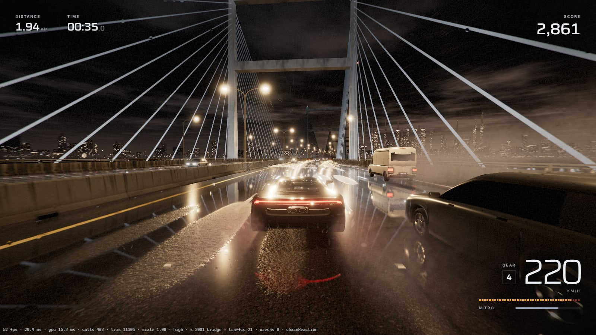

# NIGHTSHIFT: Survive the Midnight

A cinematic night-driving game that runs in the browser. A modern, unbranded sports car on an endless,
rain-soaked highway: thread through traffic, burn nitro, survive two scripted set pieces (a tanker pile-up
and a tanker falling from an overpass) and see how far you get before the car is wrecked.

TypeScript + Vite + Three.js (WebGL2), Rapier for crash physics, custom GLSL for the road, weather, VFX and
buildings, Web Audio with everything synthesised at runtime. No backend, no API keys, no network requests
after the page has loaded: the production build is a folder of static files.



## How this was made

This game was written by **Claude Fable 5.2** (extra-high effort) running as an agent in **Claude Code**, from the same long prompt that was given to Gemini 4 Carbon for a side-by-side comparison. No human wrote any of the code. Fable planned the work, split parts of it across Claude Opus 5.5 sub-agents, wrote every system, built its own browser test harness and checked the game in a real browser on its own.

- Total working time was about 16 h 36 min, including modelling the player car from scratch in Blender with a Python script (`tools/car/`). Breaks in between were only usage limits running out.
- No human code: I only reported bugs I found while playing; Fable found the root causes and fixed them itself.
- Full write-up and both games side by side: <https://lab.edizegemercan.com/posts/nightshift-gemini-4-carbon-vs-claude-fable-5-2/>
- Added afterwards, not part of Fable's output: the GitHub Pages workflow (`.github/workflows/pages.yml`), the `LICENSE` file and this section. The project's internal notes and the agent instruction file were left out of this public copy.

**License:** Code: MIT (see `LICENSE`). Third-party textures and fonts: see `ASSETS.md`.

## Run it

Requirements: Node.js 22 or newer (developed on Node 24) and a browser with WebGL2. Tested in Chrome only
(desktop, Windows 11); Edge should behave the same, Firefox and Safari are untested.

```bash
npm install
npm run dev        # development server, http://127.0.0.1:5173
npm run build      # type-check + production build into dist/
npm run preview    # serve dist/ locally, http://127.0.0.1:4173
```

Other scripts: `npm run typecheck`, `npm test` (unit tests, vitest), `npm run build:fast` (build without the type-check).

## Controls

| Key | Action |
| --- | --- |
| W / Up | Accelerate |
| S / Down | Brake (reverse from a standstill) |
| A, D / Left, Right | Steer |
| Space | Handbrake |
| Shift | Nitro |
| C | Camera (chase / hood) |
| Esc | Pause |
| Enter | Confirm / play again |

Menus work with the mouse or with the arrow keys and Enter.

## What is in the game

- **Driving**: a custom arcade-leaning vehicle model (120 Hz fixed step) with weight transfer feel, wet-road grip,
  a lane-change assist that holds the heading, handbrake slides, nitro with a recharge on near misses, a damage
  ("integrity") meter and one-hit kills on hard impacts.
- **Endless road**: procedurally generated in 220 m chunks, four lanes plus a hard shoulder, curves, zones
  (city, industrial, cable-stayed bridge, tunnel, unlit rural stretch), overpasses, gantries, guardrails,
  noise walls, signs. Chunks are built ahead and recycled behind; long runs do not grow memory.
- **Traffic**: eight vehicle types (four cars, van, box truck, articulated truck, tanker), pooled, with
  car-following and lane-change behaviour, brake lights and indicators, oncoming traffic on the other
  carriageway, density and aggression that rise with distance.
- **Score**: distance points that scale with speed, near misses with a combo multiplier, risk bonuses
  (sustained high speed, threading between two vehicles, surviving the set pieces). Best score in `localStorage`.
- **Crashes**: the car is handed to a Rapier rigid-body world and tumbles; traffic piles into wrecks; fire,
  smoke, sparks, debris, explosions with shockwave distortion, slow motion and an orbiting crash camera.
- **Set pieces** (both happen in play, both can be forced from the console, see below):
  - **Highway Chain Reaction**: a box truck jack-knifes in front of a tanker; the pile-up blocks most of the
    road and the tanker explodes. Warning banner ("KEEP LEFT"), then about three seconds to get to the
    leftmost lane, which stays open.
  - **The Last-Second Escape**: a tanker breaks through the railing of an overpass ahead and drops onto the
    player's side of the road; the banner names the side that stays open.
  - Wrecks stay where they crash, but no pile of them closes the whole carriageway: whatever reaches into
    the last open outer lane is pushed back out, so there is always a way through.
- **Rendering**: PBR, an analytic street-lamp light field, planar reflections on the wet road with stretched
  highlights, an environment probe for the car paint, rain streaks, lens drops, tyre spray, splashes,
  lightning, soft particles, HDR bloom, ACES tone mapping, film grain, speed blur. Only the scene pass is
  multisampled.
- **Audio**: engine (AudioWorklet synthesiser), tyres, rain, tunnel reverb, pass-bys, impacts, explosions,
  thunder, UI sounds. No audio files are shipped.
- **Quality**: LOW / MEDIUM / HIGH / ULTRA presets and dynamic resolution driven by a GPU timer. If the player
  never picked a preset and the GPU cannot hold the frame budget at the lowest resolution, the game steps down
  one preset by itself.

## Quality presets and measured performance

Measured on the production build with `tools/scripts/perf.mjs`, 1920×1080, vsync off, headless Chrome through
ANGLE / Direct3D 11, NVIDIA RTX 4060 Ti, Ryzen 7 5700X, autopilot driving in city traffic, 14 s per preset:

| Preset | Frames per second | Frame interval (avg) | GPU timer | Draw calls | Triangles |
| --- | --- | --- | --- | --- | --- |
| LOW | 377 | 2.7 ms | 2.0 ms | 160 | 0.57 M |
| MEDIUM | 226 | 4.4 ms | 4.3 ms | 386 | 1.17 M |
| HIGH (default) | 211 | 4.7 ms | 4.6 ms | 438 | 1.32 M |
| ULTRA | 180 | 5.6 ms | 5.4 ms | 478 | 1.47 M |

So 1080p at 60 frames per second holds on this machine with about three times the budget to spare (LOW runs
at a 0.8 pixel ratio). Nothing was measured on other hardware: on an integrated GPU expect LOW or MEDIUM, and
the automatic step-down to kick in. MEDIUM, HIGH and ULTRA are close because the frame is limited by
draw-call submission on the CPU, not by pixels.

The table was measured with the previous player car. The project's own car (11 November) draws 6 to 12 more
calls per frame and 0.07 to 0.15 M fewer triangles. Measured back to back against the previous build while the
machine was in use (so both are below the table): LOW 233–251 against 265–268, MEDIUM 143–147 against 151–166,
HIGH 130–137 against 123–148, ULTRA 115–126 against 120–138 frames per second, that is about 5 to 10 % behind
outside HIGH, with about 0.4 ms more GPU time per frame. Details: [docs/TEST_REPORT.md](docs/TEST_REPORT.md).

## Debug and test hooks

URL parameters: `?q=low|medium|high|ultra` (force a preset), `?debug` (status line with frame time, GPU time,
draw calls), `?autostart=1`, `?autopilot=1`.

Console (`window.__NS`): `start()`, `autopilot(true)`, `teleport(s)`, `trigger('chainReaction')`,
`trigger('lastSecondEscape')`, `setQuality('low')`, `stats()`.

Automated browser checks (headless system Chrome through Playwright, real GPU):

```bash
# whole game loop, 46 pass/fail checks, screenshots into screenshots/
node tools/shot.mjs --page "index.html?debug" --script tools/scripts/gameflow.mjs --timeout 120000
# the same against the production build
node tools/shot.mjs --dist --page "index.html?debug" --script tools/scripts/gameflow.mjs --timeout 120000
# long autopilot run with black / blown-out frame detection
node tools/shot.mjs --page "index.html?debug" --script tools/scripts/soak.mjs --secs 200 --dark 1
# per-preset performance
node tools/shot.mjs --dist --page "index.html?debug" --script tools/scripts/perf.mjs --size 1920x1080 --no-vsync
# dist/ served by a plain static file server under a sub-path, no external requests allowed
node tools/static-check.mjs
```

Results of the last run are in [docs/TEST_REPORT.md](docs/TEST_REPORT.md).

## Deploying to Cloudflare Pages

The build uses relative URLs (`base: './'`), so `dist/` works at a domain root or in any sub-folder, on any
static host. Nothing needs to be configured at runtime.

Git integration (Cloudflare dashboard → Workers & Pages → Create → Pages → Connect to Git):

| Setting | Value |
| --- | --- |
| Framework preset | None (or Vite) |
| Build command | `npm run build` |
| Build output directory | `dist` |
| Environment variable | `NODE_VERSION` = `22` (or newer) |

Direct upload from this machine instead:

```bash
npm run build
npx wrangler pages deploy dist --project-name nightshift
```

`dist/` is about 19 MB in 33 files. The JavaScript is split in three: the game (0.60 MB, 0.22 MB gzipped),
three.js (0.75 MB, 0.19 MB gzipped) and the physics engine with its WebAssembly (4.3 MB, 1.7 MB gzipped),
which is fetched in parallel with the models and textures; every file is far below the Pages limit of 25 MB.
The game has not been published anywhere; these are instructions only.

## Project layout

```
index.html            entry page (canvas + UI root)
src/main.ts           bootstrap: loads assets, wires the systems, exposes window.__NS
src/core/             shared types, event bus, input, quality presets, math
src/game/             state machine, player, collisions, score, cinematic director, test autopilot
src/vehicle/          vehicle simulation, camera rig, player car visual
src/traffic/          traffic AI, vehicle factory (models + LOD), oncoming traffic
src/physics/          Rapier crash world
src/world/            road path and profile, chunk builder, road shader, lamp light field,
                      roadside furniture, structures (bridge, tunnel, overpass), backdrop (city, terrain)
src/render/           engine, frame graph, planar reflection, environment probe, post effects, GPU timer
src/vfx/              explosions, fire, smoke, sparks, debris, decals, nitro, distortion
src/weather/          rain streaks, lens rain, tyre spray, splashes
src/audio/            procedural audio (engine worklet, loops, one-shots, mixer)
src/ui/               menu, HUD, pause, game over (DOM + CSS)
src/sandbox/, sandbox/  per-system test pages (development only, not in the production build)
public/assets/        models, textures, fonts shipped with the game
tools/                browser harness (shot.mjs), test scripts, asset build scripts (car, traffic, textures)
tests/                unit tests (vitest)
docs/                 test report, per-module asset notes
```

## Known gaps

- Keyboard only: no gamepad, no touch controls; the layout is not adapted to phones.
- Performance was measured on one desktop GPU; no measurements on laptops, integrated GPUs or Safari.
- The unlit rural stretch is dark by design; exposure and a faint sky fill adapt there so the car and the
  verge stay readable, but it is the least detailed part of the world.
- The first frames of a detonation are a white-hot core with rays now instead of a flat white frame, but
  under street lamps the wet road around it still goes cream-white for a frame or two. Close-up flames
  were only checked on the LOW preset.
- Traffic that has stopped behind a pile-up does not back out or merge: it waits there until it is far
  behind the player. A player who stops inside the jam has to work their own way out.
- Traffic vehicles are original low-detail models (8–12 k triangles): convincing at speed, plain when parked next to them.
- The player car has no visible driver and no interior view; damage is shown by smoke, sparks and the meter, not by deformation.
- Without Web Worker support (or with a policy that forbids blob workers) the sounds are rendered on the main
  thread, which stalls the first second of play by about 0.6 s.
- The test autopilot is a test tool, not a perfect driver: it follows the warning banners of both set
  pieces and backs out from behind a wreck, but long unattended runs can still end in a crash or with the
  car standing in a jam for a long time.

## Credits and licences

Third-party assets (textures, fonts) and their licences are listed in [ASSETS.md](ASSETS.md); none of them
requires attribution. The player car and the traffic vehicles are made by this project: modelled from code in
headless Blender 4.3 (`tools/car/`, `tools/traffic/`), no downloaded models.

Rebuilding the player car (Blender 4.3, command line; details and the file contract in
[docs/assets/car.md](docs/assets/car.md)):

```bash
"C:/Program Files/Blender Foundation/Blender 4.3/blender.exe" --background --factory-startup --python tools/car/build_car.py
node tools/car/pack.mjs    # checks the model, compresses it into public/assets/models/player_car.glb
```
